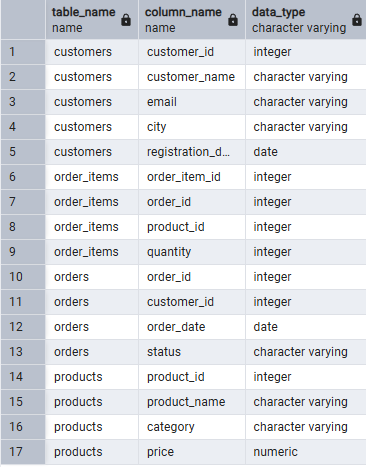
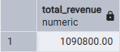
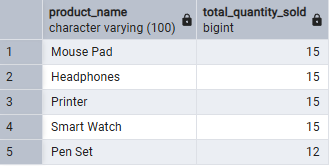
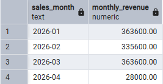

# E-commerce Sales Data Analysis Using PostgreSQL

## 1. Project Overview

This project analyses sample e-commerce sales data using PostgreSQL to identify business trends and generate meaningful insights.

The analysis focuses on sales performance, customer purchasing behaviour, product performance, revenue generation and order status.

The project demonstrates practical SQL skills through real-world business questions.

## 2. Business Objectives

- Calculate total sales revenue and average order value.
- Identify the highest-spending customers.
- Find the best-selling products.
- Analyse revenue by product category.
- Evaluate monthly sales performance.
- Examine customer order activity.
- Analyse order status distribution.

## 3. Tools and Technologies

| Tool | Purpose |
|---|---|
| PostgreSQL 18 | Database management and SQL analysis |
| pgAdmin 4 | SQL query execution |
| GitHub | Project hosting and documentation |

## 4. Database Structure

The project contains four relational tables:

| Table | Description |
|---|---|
| Customers | Customer information |
| Products | Product names, categories and prices |
| Orders | Customer order details |
| Order_Items | Products and quantities in each order |

### Dataset Overview

| Table | Records |
|---|---:|
| Customers | 20 |
| Products | 20 |
| Orders | 30 |
| Order_Items | 60 |
| **Total** | **130** |

*Note: The dataset contains sample transactional records created for learning and analysis.*

## 5. SQL Concepts Used

**Basic SQL**
- SELECT, WHERE and DISTINCT
- ORDER BY and LIMIT
- Aggregate functions (COUNT, SUM, AVG, MIN, MAX)

**Intermediate SQL**
- GROUP BY and HAVING
- INNER JOIN and LEFT JOIN
- Multiple table joins
- Subqueries
- CASE statements

**Advanced SQL**
- Common Table Expressions (CTEs)
- Window functions
- ROW_NUMBER(), RANK() and DENSE_RANK()
- PARTITION BY
- Running totals
- Date and time functions

## 6. Business Analysis

The project answers the following 10 business questions:

1. What is the total revenue generated?
2. How many orders have been placed?
3. What is the average order value?
4. Which are the top five best-selling products?
5. Which products generate the highest revenue?
6. Which product categories generate the most revenue?
7. Who are the top five highest-spending customers?
8. Which customers have not placed any orders?
9. How does revenue vary month by month?
10. What is the distribution of orders by status?

## 7. Project Structure

```text
Ecommerce-Sales-Analysis/
│
├── Queries/
│   ├── 01_Basic_Analysis.sql
│   ├── 02_Intermediate_Analysis.sql
│   └── 03_Advanced_Analysis.sql
│
├── Analysis/
│   └── Business_Insights.md
│
├── Screenshots/
│   ├── database_tables.png
│   ├── total_revenue.png
│   ├── top_5_products.png
│   └── monthly_revenue.png
│
└── README.md
```

## 8. Key Learnings

Through this project, I gained practical experience in:

- Working with relational databases.
- Writing SQL queries for data analysis.
- Combining multiple tables using JOINs.
- Analysing customer and product performance.
- Calculating revenue and business metrics.
- Using aggregate functions and subqueries.
- Converting business requirements into SQL queries.
- Presenting findings through business insights.

## 9. Project Screenshots

### Database Structure


### Total Revenue Analysis


### Top Five Best-Selling Products


### Monthly Revenue Analysis


## 10. Conclusion

This project demonstrates the use of PostgreSQL to analyse e-commerce data and solve practical business problems.

It helped develop my SQL querying, data analysis and business interpretation skills.

**Project Status:** Completed

**Author:** Amogh Roy S
